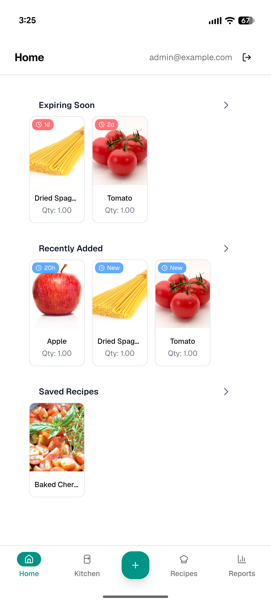
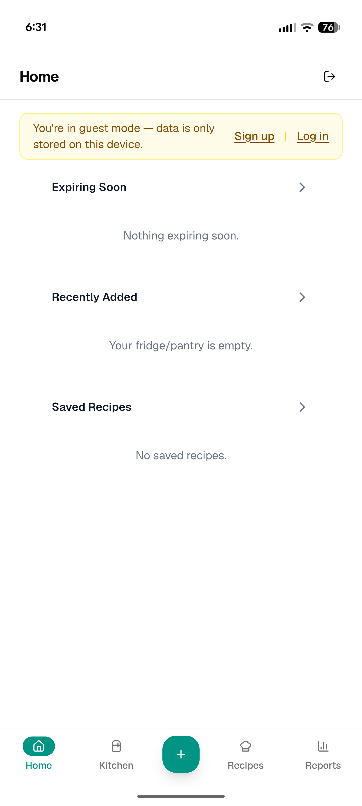
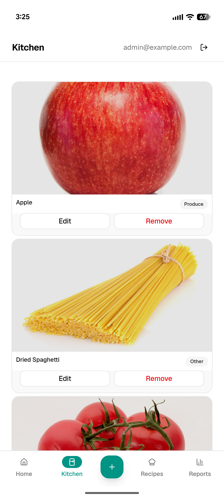
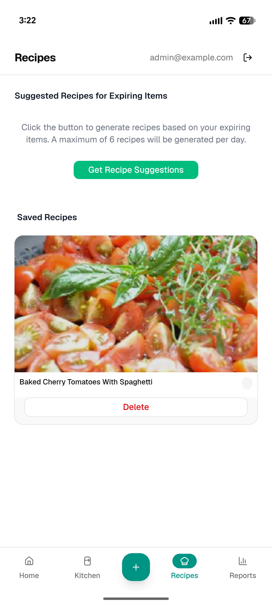
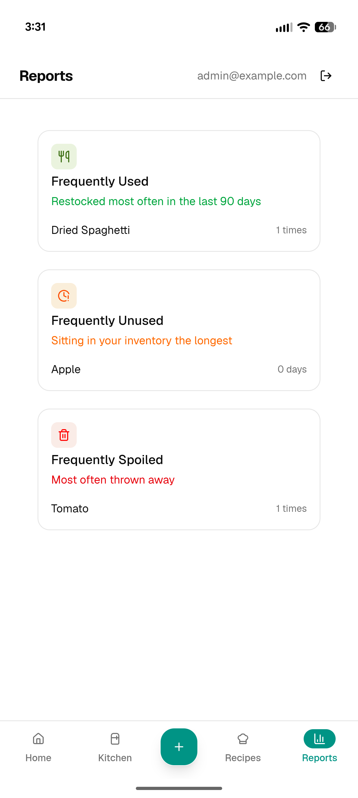

# FridgePulse

This fork of the full-stack web application [Smart Grocery Housekeeping](https://github.com/dimitry16/Smart-Grocery-Housekeeping) was created to do a full overhaul of the frontend and backend, including a UI redesign and new features.

<div align="center">
  
  
  
  <br>
  
  
</div>

## Key Features

- **Inventory Management** 
    - Add, update, and delete food items with details such as brand, category, quantity, and expiration date
- **Barcode Scanning** 
    - Scan product barcodes with your camera to auto-populate item details via the Open Food Facts API
- **Produce Recognition** 
    - Identify fruits and vegetables using computer vision through your device’s camera
- **Guest Mode & Offline Support**
    - Use the app as a guest or offline, with all data stored locally in the browser (IndexedDB)
    - Locally stored data syncs automatically to the database once you create an account
- **Recipe Suggestions**
    - Get recipe ideas based on items expiring within three days via the Spoonacular API
- **Usage Reports**
    - Track consumption patterns and food waste analytics
- **Expiration Alerts**
    - Color-coded badges show when each item was added and whether it’s expired, expiring soon, or still fresh
- **Self-Hosting**
    - Self-host the app through Docker
- **PWA Support**
    - Install the app on your device and use it like a native mobile app

## Tech Stack

| Layer | Technologies |
|-------|-------------|
| Frontend | React 19, React Router 7, Tailwind CSS, shadcn/ui |
| Backend | Python, FastAPI, SQLAlchemy, Alembic |
| Database | PostgreSQL (Neon), Dexie.js (IndexedDB) for Guest/Offline Mode |
| Authentication | JWT with Argon2 |
| External APIs | Open Food Facts, Spoonacular |
| Infrastructure | Docker, FastAPI Cloud, GitHub Actions |

## Setup

### Docker Setup

1. Create your environment file:

   ```bash
   cp .env.example .env
   ```

2. Edit `.env` before starting the app. Set the PostgreSQL username, password, and database name, and choose the initial admin email and password. Replace `SECRET_KEY` with a random value; generate one with:

   ```bash
   openssl rand -hex 32
   ```

   Spoonacular integration is optional; set `SPOONACULAR_API_KEY` if you want recipe suggestions.

3. Build and start the app:

   ```bash
   docker compose -f compose.yml -f compose.deploy.yml up --build -d
   ```

   Open [http://localhost:5173](http://localhost:5173). On startup, the backend waits for PostgreSQL, runs database migrations, and initializes the app.

## License

All code is licensed under the Apache License, Version 2.0. See the LICENSE file for details.
